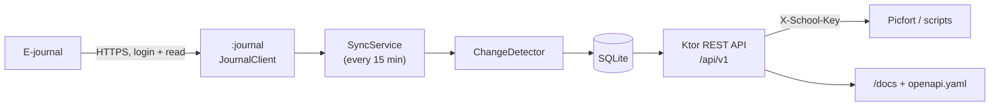

# School Server — Specification (v0.2)

This is the product specification. **How** things are built is decided in
[ADRs](adrs/README.md); the API contract is [`api/openapi.yaml`](api/openapi.yaml); work is
split into [tasks](tasks/README.md) tracked in [STATUS](STATUS.md). When this file and an ADR
disagree, the newer ADR wins and this file gets fixed.

## 1. Goal

A small self-hosted server that:

1. logs in to the school **e-journal** with a **parent account** on its family portal
   (provider name, hosts and reference implementations: git-ignored `private/journal-references.md`);
2. every 15 minutes reads **grades** and **messages** (read-only in v1);
3. **detects changes** (new / changed / removed) against what it stored before;
4. serves the data and a **change feed** through a REST API protected by one API key
   (same idea as `picfort-server`'s `PICFORT_API_KEY`);
5. later feeds the **school screen in the Picfort app**, as an optional add-on.

### 1.1 Owner decisions (2026-11-16)

| Topic | Decision |
|---|---|
| Account | Parent account, one account in v1 |
| Independence | Separate server and container; Picfort must not depend on it (unofficial access may break the provider's terms) |
| Naming | Repository is **public** and never names the provider (code, docs, commits). Names and hosts only in git-ignored `private/journal-references.md` |
| Data source | Parent portal login → JSON API v3 (grades) + new messages service (messages); no HTML scraping ([ADR 0011](adrs/0011-journal-data-source.md)) |
| Auth | One shared API key |
| Read state | Tracked by this server only; fetching message bodies is fine |
| First sync | Reports **every** grade and message as `created` |
| Interval | 15 minutes |
| Hosting | Same machine as Picfort, port 5100 (Picfort: 5000), exposed through Cloudflare Tunnel |
| Scope v1 | Grades and messages only |
| Credentials | Login, password and the e-journal address in `.env` |
| Stack | Kotlin + Ktor (Picfort server will migrate to the same) |
| Autonomy | Agents decide on their own and record decisions (see AGENTS.md) |

## 2. Scope

### 2.1 v1
- Login, session keeping, re-login on expiry; stop after a rejected password.
- Read grades (subject, value, weight, category, semester, kind, teacher, comment, date).
- Read received messages (list + body, attachment names).
- Change detection with a persistent change feed.
- REST API + OpenAPI docs + Swagger UI; local read state for messages.
- Docker image, `.env` configuration, CI.

### 2.2 Later
- **v1.x:** announcements, attendance, homework, test calendar, timetable, lucky number.
- **v2:** **sending messages** and other write actions (needs an ADR that lifts AGENTS.md rule 1
  for those endpoints), push to Picfort (webhook/SSE), several accounts/children, downloading attachments.

The design keeps this open: `JournalClient` is read-only today; writes will come as a separate
`JournalWriter` interface, and the API grows additively under `/api/v1` (ADR 0010).

## 3. Users and use cases

| Actor | Wants to |
|---|---|
| Parent (owner) | Install with Docker, fill `.env`, forget about it |
| Picfort app | Show grades, unread messages and "what's new" on the school screen |
| Scripts | Poll `/changes` and send their own notifications |

- **UC1** "New grades since last time" → `GET /api/v1/changes?after=<cursor>&type=grade`
- **UC2** "Unread messages" → `GET /api/v1/messages?unread=true`
- **UC3** "Maths grades and average" → `GET /api/v1/grades/subjects`
- **UC4** "Is the data fresh?" → `GET /api/v1/status`

## 4. Architecture



- Gradle modules `:model` (domain + DTOs + `JournalClient`), `:journal` (provider adapter),
  `:server` (Ktor, store, sync) — [ADR 0001](adrs/0001-kotlin-ktor-stack.md).
- Data source inside `:journal` (HTML pages vs JSON Gateway API) is decided in T-005 → ADR 0011.
- SQLite + SQLDelight with verified migrations — [ADR 0002](adrs/0002-sqlite-storage.md).
- Polling and change detection — [ADR 0003](adrs/0003-polling-and-change-detection.md).

## 5. Data model

Exact field types: [`api/openapi.yaml`](api/openapi.yaml) schemas; storage: [T-003](tasks/T-003-sqlite-store.md).

- **Grade** — `id` (`g_<e-journal id>`), subject, value (`"4+"`), numericValue (4.5), weight,
  category, semester, kind (`regular | proposed_semester | semester | proposed_final | final`),
  countsToAverage, teacher, comment, issuedOn, firstSeenAt, updatedAt, deletedAt.
- **Message** — `id` (`m_<e-journal id>`), sender, subject, sentAt, bodyText, bodyHtml
  (sanitised), attachments (names), read/readAt (**local**), deletedAt. Received folder only.
- **ChangeEvent** — monotonic `id` (cursor), entityType, entityId, changeType, diff, detectedAt.
- **SyncRun** — start/finish, status (`running | ok | error | auth_failed`), error code, counts.

The provider's own read flag is ignored ([ADR 0007](adrs/0007-local-read-state.md)).

## 6. API

Contract: [`api/openapi.yaml`](api/openapi.yaml). Integration guide: [`api/README.md`](api/README.md).
Served live at `/api/v1/openapi.yaml` and `/docs` ([ADR 0010](adrs/0010-openapi-contract-first.md)).

| Method | Path | Purpose |
|---|---|---|
| GET | `/health` | Liveness (no key) |
| GET | `/api/v1/status` | Sync state, counts, `lastEventId` |
| GET | `/api/v1/grades` | Grades (filters: subject, semester, kind, since) |
| GET | `/api/v1/grades/subjects` | Grades per subject + weighted average |
| GET | `/api/v1/messages` | Messages without body (unread, since, paging) |
| GET | `/api/v1/messages/{id}` | One message with body |
| PUT / DELETE | `/api/v1/messages/{id}/read` | Mark read / unread (local) |
| POST | `/api/v1/messages/read-all` | Mark all read (local) |
| GET | `/api/v1/changes` | Change feed (`after` cursor or `since`) |
| POST | `/api/v1/sync` | Sync now (max once per 5 min) |

Auth: `X-School-Key`, `401` + `WWW-Authenticate: School-Key`, 10 wrong keys / 15 min per client
address → `429`; behind Cloudflare the address is `CF-Connecting-IP`
([ADR 0004](adrs/0004-api-key-auth.md)). Errors: `{"error": {"code", "message"}}`.
No endpoint ever writes to the e-journal in v1.

## 7. Sync and change detection

See [ADR 0003](adrs/0003-polling-and-change-detection.md). In short: every 15 min + jitter, one
at a time; backoff on errors; a rejected login sets `auth_failed` and stops all attempts until
restart (protects the account from lockout); `deleted` only after a complete fetch; first sync =
everything `created`; message bodies fetched only for new messages; server timezone `Europe/Warsaw`, API in UTC.

## 8. Non-functional requirements

- **Security:** credentials only in `.env` / `SCHOOL_PASSWORD_FILE`, never logged or returned
  ([ADR 0008](adrs/0008-credentials.md)); port not opened on the router; `Cache-Control: no-store`;
  children's data is personal data (GDPR): stored locally only, no telemetry, real data never in git.
- **Reliability:** API serves stored data when the e-journal is down.
- **Performance:** API answers < 200 ms from the local DB; idle RAM < 200 MB.
- **Robustness to e-journal changes:** parsers tested on anonymised fixtures; unknown layout →
  clear `layout_changed:*` error, never mass deletes.
- **Operability:** readable logs, `/api/v1/status`, Docker healthcheck.

## 9. Configuration and installation

Same experience as picfort-server ([ADR 0005](adrs/0005-docker-distribution.md)):

```sh
mkdir school-server && cd school-server
wget -O docker-compose.yml https://github.com/ljarka/school-server/releases/latest/download/docker-compose.yml
wget -O .env https://github.com/ljarka/school-server/releases/latest/download/example.env
# fill in the three SCHOOL_JOURNAL_* addresses, SCHOOL_LOGIN, SCHOOL_PASSWORD, SCHOOL_API_KEY; chmod 600 .env
docker compose up -d
```

| Variable | Default | Meaning |
|---|---|---|
| `SCHOOL_JOURNAL_DOMAIN` | — | E-journal main domain; portal, API, messages and gateway addresses are derived from it (required unless the URLs below are all set) |
| `SCHOOL_JOURNAL_URL` | from domain | Override: family portal address (`https://`) |
| `SCHOOL_JOURNAL_API_URL` | from domain | Override: e-journal JSON API address |
| `SCHOOL_JOURNAL_MESSAGES_URL` | from domain | Override: messages service address |
| `SCHOOL_JOURNAL_GATEWAY_URL` | from domain | Override: gateway address for school-issued logins (ADR 0012) |
| `SCHOOL_LOGIN` | — | Parent portal e-mail, or school-issued login without `@` (required) |
| `SCHOOL_CHILD` | all children | Restrict sync to one child (id or login) (ADR 0013) |
| `SCHOOL_PASSWORD` | — | Parent password (required unless `_FILE`) |
| `SCHOOL_PASSWORD_FILE` | — | File with the password (Docker secret); wins over `SCHOOL_PASSWORD` |
| `SCHOOL_API_KEY` | — | API key; required with `TRUST_PROXY=cloudflare` |
| `TRUST_PROXY` | — | `cloudflare` → client address from `CF-Connecting-IP` |
| `SYNC_INTERVAL_MINUTES` | 15 | Min 5 |
| `SCHOOL_DB_PATH` | `/data/school.db` (image), `./school.db` (local) | Database file |
| `PORT` | 5100 | Port inside the container / process |
| `LOG_LEVEL` | INFO | DEBUG, INFO, WARN, ERROR |
| `JAVA_OPTS` | small-heap defaults | JVM flags |
| `SCHOOL_VERSION`, `SCHOOL_PORT`, `DATA_LOCATION` | latest, 5100, ./data | Compose only |

The only env template is `docker/example.env` (also used for local runs: `cp docker/example.env .env`).

Deployment next to Picfort: separate folder, `.env` and compose project (`school` vs `picfort`),
host port 5100; reachable from outside only via `cloudflared` (`school.example.com →
http://localhost:5100`). The server refuses to start behind Cloudflare without an API key.

## 10. Picfort integration (later)

Picfort has no hard dependency: the school screen shows this data only if the user enters the
server URL and key. Picfort can reuse the `:model` DTOs or generate a client from `openapi.yaml`.
Suggested tiles: "New grades", "Unread messages", freshness badge from `/status`.

## 11. Acceptance criteria (v1)

- [ ] Logs in and syncs on the interval; `auth_failed` stops retries.
- [ ] `/grades` and `/messages` match the e-journal (checked in the live run, T-013).
- [ ] A new grade appears in `/changes` within one interval.
- [ ] First sync puts every grade and message in `/changes` as `created`.
- [ ] Request without a key → `401`; 10 wrong keys → `429`, per `CF-Connecting-IP` behind Cloudflare.
- [ ] Read state is local and survives a container restart.
- [ ] Every API response validates against `openapi.yaml`; `/docs` works.
- [ ] Password and key never appear in logs, even at DEBUG; `SCHOOL_PASSWORD_FILE` works.
- [ ] No provider name in public files (CI); module boundaries hold (CI).
- [ ] README install works on a clean machine in 3 steps; image runs on amd64 and arm64.

## 12. Open assumptions

Recorded in [STATUS](STATUS.md#assumptions); agents may change them by recording a decision.
